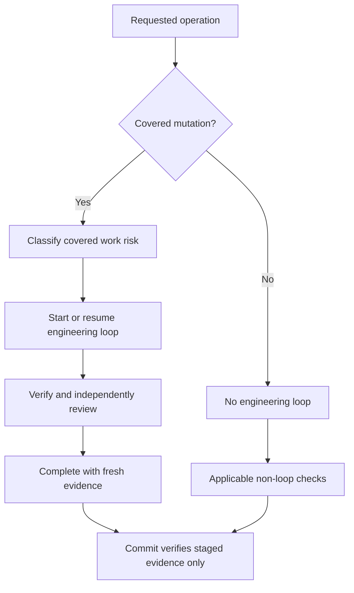
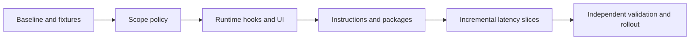

# Execution Plan: Scoped Engineering Loops and Latency Optimization

**Author**: GitHub Copilot
**Date**: 2026-10-09
**Status**: In Progress - user authorized implementation on 2026-10-09

## Purpose / Big Picture

Frontier MUST require an engineering quality loop only when creating, modifying,
renaming, or deleting PRDs, technical specifications, production/tooling code, or
unit tests. Research, review-only work, and commit-only operations MUST NOT start
their own loops. Existing safety, independent review, and applicable CI checks
remain required; exemption from a loop is not exemption from verification.

Combine this policy change with the eight latency improvements identified in the
read-only repository assessment. Keep TypeScript and PowerShell for this work;
a wholesale Python migration is out of scope and not supported by measurements.

This is a living plan. Keep Progress, Surprises & Discoveries, Decision Log, and
Outcomes & Retrospective current during implementation.

## Alternatives Considered

- Change instructions only: rejected because runtime, extension, runner, and
  generated Git hooks would continue enforcing the old policy.
- Exempt entire agent roles: rejected because a reviewer applying a code fix
  MUST enter a code loop, while an engineer doing research MUST remain exempt.
- Remove loops and commit checks entirely: rejected because covered changes
  still need fresh, independent evidence.
- Decide applicability from operation plus artifact scope, then classify risk:
  selected. This narrows loops without weakening covered-change evidence.
- Rewrite the runtime in Python: deferred. First remove unnecessary model calls,
  traversal, queue waits, and repeated process launches, then measure again.

## Progress

- [x] Initial plan drafted
- [x] Controlling loop classifier, extension parity model, and nearby tests read
- [x] Validation approach defined
- [x] Loop groups, iteration minima, and loop-free work allocated per item
- [x] User approves policy boundaries and implementation sequence
- [x] Implementation started
- [x] Policy core, staged evidence and instruction source changes implemented
- [x] Two independent preliminary technical reviews performed and findings repaired
- [ ] Final policy contract gaps, council approval and L-P completion resolved
- [ ] Acceptance and performance evidence recorded

### Repository Update Checkpoint (2026-10-09)

- User approved preserving local work and updating from the remote 9.8 branch.
  Checkout HEAD is `137886fa`, from
  `origin/chore/pending-agent-names-and-docs-428`; root version is `9.8.0`.
  Remote `master` and its latest tag remain at `9.6.0`.
- Local changes were reapplied and 42 Git conflicts resolved. Safety copies remain
  in `.git/frontier-update-backups/20261009-184605` and Git stash
  `63da3ef57f8c179f6a7ead4d0e483955ff62b0c1`. No local commit or push was made.
- The existing owning loop remains active at iteration 3/20, minimum 5. All 13
  original state/evidence files were verified unchanged; this update does not
  complete the older policy or latency implementation.
- Merge verification includes extension no-emit typechecking, changed PowerShell
  syntax checks, clean diff/conflict checks, 637 frontmatter checks, read-scope
  CLI smoke inspection and advisory scrub. Independent merge findings prompted
  bound fixture approvals, post-commit fixes and updated freshness diagnostics.
- Adopt 9.8's guided interaction and separate post-loop test-consent contract.
  Prior suite results below describe the pre-update code, not this merged state.
  Suites were not rerun during synchronization; final owning-loop review,
  council, post-loop execution and performance measurements remain pending.

### Publication Checkpoint (2026-10-12)

- GitHub authentication and ADMIN repository access were verified. The user
  approved reconciliation and delivery through a PR, not a direct master merge.
- `feat/scoped-loop-policy` now starts at remote master `a557d2b9`, version
  `9.8.1`. Reapplying the saved policy delta merged three overlapping files
  without conflicts; the 9.8.1 fixes were retained. Original master remains
  unchanged. No delivery commit, push or PR has been created yet.
- Current work and ignored loop evidence were copied to
  `.git/frontier-publish-backups/20261012-120645`; stash
  `a6ce6c2fe291e09ce201d5e9486949ab5ebdcc4d` remains available. The loop-state
  digest was verified unchanged through reconciliation.
- Changed PowerShell parsing, extension no-emit typechecking and diff checks
  passed. These are non-test checks; no suites ran and prior results remain
  historical. Preliminary delivery review requested changes, not approval.
- Review repairs address verification-skipping commit flags, composed commits,
  Git verification overrides, path-safe unresolved shell scope and portable
  Node discovery. Regression cases were authored; execution remains deferred.
- The unrelated nested `copilot/` repository is preserved and locally excluded
  through `.git/info/exclude`, not deleted or staged for this delivery.
- The original owning L-P loop recorded a fresh work checkpoint at 4/20.
  After the user delegated the baseline-transition choice, additive
  `loop adopt-scope --include-existing-changes` included 15 covered mutations.
  Actual checks confirmed unchanged history, startedAt, iteration count,
  original code-quality baseline hash and engineering baseline hash. This
  grants no approval; the new migration's authority policy still needs repair.
- The official GitHub Models catalog returned HTTP 200 with plain `OK`, not
  model JSON. The official Copilot SDK alternate catalog was authenticated and
  supported genuine independent calls. Analyst `gpt-5.6-sol` and Strategist
  `claude-opus-5.5` succeeded. Initial Skeptic `grok-4.7` timed out after
  180000 ms; bounded replacement `gpt-5.4` succeeded. All three successful
  selections were confirmed by the host before and after their calls.
- Council execution is complete, not approval. All successful members requested
  changes. The failed attempt, exact provenance, shared-provider limitation and
  findings are recorded in
  `docs/artifacts/reviews/COUNCIL-loop-scope-2026-10-12.md`. Underlying model
  snapshots and inference costs were not measured or claimed.
- Publication remains BLOCKED by semantic Git token/control-plane bypasses,
  missing declared ordinary-name PRD/TechSpec coverage, general migration
  authorization and regression gaps, and missing final digest-bound approval.
  Acceptance scope MUST NOT be narrowed silently. Latency packages remain
  outside this PR delivery. No commit, push, PR or merge has been performed.

## Surprises & Discoveries

- Observation: Both current task-class classifiers return a loop class for every
  request, including research and review. Applicability and risk are conflated.
  Evidence: `.frontier/runtime/frontier-cli.ps1` Get-LoopTaskClass and
  `vscode-extension/src/runtime/loopState.ts` inferLoopTaskClass.
- Observation: Existing scope tests concern affected-test selection and evidence,
  not whether an operation needs a loop. Reuse them where suitable, but add
  applicability cases to the existing parity and policy test surfaces.
  Evidence: `tests/loop-scope-behavior.ps1` and `tests/loop-parity-behavior.ps1`.
- Observation: Seven fresh-process samples measured medians of 348.5 ms for a
  PowerShell no-op and 609.1 ms for Frontier version on this Windows machine.
  Evidence: previous assessment terminal output; no live-provider timings taken.
- Observation: Windows extension tests require Git Bash before Windows Bash on
  PATH and a sufficient async timeout. With those prerequisites, the complete
  extension unit suite passed 1,130 tests without changing unrelated source.
- Observation: Review found applicability bypasses not covered by initial tests:
  unknown extensions, hardlink aliases, broad integration names, missing handoff
  snapshots, invalid operations and workspace-parent directory names. Repairs
  now have focused regressions; final independent approval remains pending.

## Decision Log

- Decision: Applicability MUST be decided before risk or minimum iterations.
  Options Considered: prompt keywords, agent role, operation/artifact scope.
  Chosen: explicit operation and normalized artifact scope, verified against
  actual mutations and staged changes; prompt/role text is not bypass authority.
  Rationale: research about security is exempt, but a security code edit is not.
  Date/Author: 2026-10-09 / GitHub Copilot, proposed for user approval.
- Decision: Commits MUST NOT create loops. Covered staged changes MUST still be
  bound to completed, unconsumed, approved evidence for the exact staged content.
  Rationale: verify the engineering work once without looping the commit action.
  Date/Author: 2026-10-09 / GitHub Copilot, proposed for user approval.
- Decision: Preserve current risk-based iteration minima for covered work.
  Rationale: this request changes applicability, not iteration counts.
  Date/Author: 2026-10-09 / GitHub Copilot, proposed for user approval.

## Context and Orientation

Primary implementation surfaces:

- `.frontier/runtime/frontier-cli.ps1`: applicability, loop lifecycle, policy-hook,
  generated Git hooks, script wrappers, and commit evidence checks.
- `.frontier/runtime/agentic-runner.ps1`: automatic loop/self-review behavior,
  provider readiness, search, compaction, and response transport.
- `vscode-extension/src/runtime/loopState.ts`, `loopStateStore.ts`, and
  `utils/loopStateChecker.ts`: runtime parity, persistence, and UI gate display.
- `vscode-extension/src/extension.ts`, `frontierContext.ts`, `chat/intentRouter.ts`,
  `chat/lmIntentClassifier.ts`, and `chat/requestRouter.ts`: startup and routing.
- `AGENTS.md`, `.github/AGENT-PROTOCOL.md`, `.github/copilot-instructions.md`,
  applicable agent/skill bodies, `CLAUDE.md`, and host wrappers: instruction parity.
- `scripts/ship.ps1`, companion execution queues, extension packaging, and
  `tests/loop-*-behavior.ps1`: orchestration, distribution, and regression coverage.

The live verification helper `runtime/verificationLoop.ts` is not the persisted
engineering quality loop. Keep useful lint/test feedback available outside loops.
Do not manually edit generated packaged mirrors; regenerate canonical assets.

## Pre-Conditions

- [x] User authorized implementation of the entire plan on 2026-10-09
- [x] Use the CLI's default local mode; no remote issue mutation is authorized
- [x] Inspect exact generated pre/post-commit logic and current policy-hook tests
- [x] Load language and agent-customization guidance for files actually edited
- [x] Multi-surface scope warrants a maintained execution plan

## Plan of Work

### Proposed Applicability Contract

| Operation/artifact | Engineering loop | Other obligations |
|---|---|---|
| Create/update/delete/rename PRD | Required | Requirements acceptance and independent review |
| Create/update/delete/rename TechSpec | Required | Contract acceptance and independent review |
| Create/update/delete/rename production or tooling code | Required | Risk-scoped verification and fresh code review |
| Create/update/delete/rename unit tests | Required | Relevant tests and independent review |
| Read/analyze/research, including security or code research | Not applicable | Honest sources, scope, and conclusions |
| Review existing PRD, TechSpec, code, or tests without edits | Not applicable | Review standards and existing change evidence |
| Review plus code/unit-test fixes | Required before the first covered edit | Re-review changed content |
| Commit/tag/push only | Not applicable | Permissions, release/security gates, covered staged evidence |
| Plans, ADRs, guides, research/review reports, and learnings | Not applicable | Their own validation and approval rules |
| Dedicated integration/E2E test artifacts, ordinary configuration, and CI YAML | Not applicable unless accompanied by covered edits | Applicable tests, security and release gates |
| Mixed work | Required only for covered mutation phases | Exempt phases do not create nested loops |

Definitions to encode and document: code includes executable application/runtime,
tooling and hook source, shell/PowerShell scripts, and infrastructure-as-code;
shared executable test helpers count as code. Dedicated integration/E2E cases
are not unit tests. PRD and TechSpec recognition MUST support canonical paths and
declared artifacts in consumer workspaces, not only this repository's paths.
Declarative agent instructions, prompts, and skill documents outside PRD/TechSpec
remain exempt from loops but retain their own validation gates.

Applicability MUST use normalized paths and operation types, not merely words
such as research, review, release, or commit. Check both paths of a rename and
record deletions explicitly. A covered mutation MUST enter the loop before it
occurs, even if the task began as exempt research. Unknown potentially mutating
operations MUST resolve their scope before proceeding; they MUST NOT silently
qualify for an exemption. Read-only inspection remains permitted.

Use a small versioned policy contract and shared parity fixtures, with thin
PowerShell/TypeScript adapters. An N/A result MUST NOT write a synthetic approved
loop, consume previous evidence, lower an active loop's minimum, or cancel a
different task's loop. Do not trust a workspace-writable exemption flag alone.

### Commit and Review Boundaries

Docs-only/exempt commits MUST work without any loop, including when an unrelated
loop is active or stale. Mixed commits MUST check their covered staged subset.
Covered commits without current approved evidence MUST fail with instructions to
complete the engineering work, not instructions to start a commit loop.
Bind evidence to the index contents, including partial staging, deletions and
renames; a worktree hash alone is insufficient. An exempt commit MUST NOT consume
another task's completed evidence. Existing post-commit consumption MUST occur
only when covered evidence was actually accepted for that commit.

A review-only operation MUST NOT need its own loop or inherit an unrelated
workspace gate. A review can still report that the implementation's engineering
evidence is missing, stale, or failed. Independent review remains part of covered
work's loop; it does not start a nested review loop. Retain independent model
council rules where currently required; do not remove them in this scope change.

Legacy completed evidence MUST remain auditable. Missing applicability metadata
MUST NOT exempt covered changes. Migrate additively; do not reset active loops,
rewrite historic approvals, or refresh evidence timestamps.

## Steps

| # | Step | Owner | Loop / minimum iterations | Status | Notes |
|---|---|---|---|---|---|
| 1 | Baseline and applicability fixtures | Engineer | Baseline: 0; covered fixture edits: L-P / 5 shared | Implemented; final review pending | CLI, runner and compiled TS share parity cases; no live latency benchmark |
| 2 | Scope policy and runtime parity | Engineer | L-P / 5 shared | In Progress | Core gates verified; declared artifacts/versioned policy contract pending |
| 3 | Runner, hooks, UI, and commit integration | Engineer | L-P / 5 shared | Implemented; final review pending | All-role snapshots, exact index scope, aliases and consumption checked |
| 4 | Instruction and distribution alignment | Engineer | Instructions/config only: 0; covered packaging code: L-P / 5 shared | Verified; owning approval pending | Latest repairs regenerated; customization 341 and host compatibility 115 passed |
| 5 | Routing, issue-loading, and readiness latency | Engineer | L-M / 3, L-R / 3, L-I / 3, L-A / 5 | Implemented; reviewed | Phase timings, classifier deadline, lazy/shared issue loads, selected-provider probes |
| 6 | Search, accounting, and process overhead | Engineer | L-S / 5, L-T / 3, L-W / 5 | Implemented; reviewed | Pruned bounded search, replay-aware estimates; resume CLI pair retained as a freshness check |
| 7 | Streaming and companion responsiveness | Engineer | L-C / 5 | Partial | WhatsApp status served outside writer queue; text-delta streaming deferred |
| 8 | Independent validation and rollout | Reviewer/Tester | Review, checks and rollout: 0 new loops | Review approved; suites pending consent | No suites or live benchmarks run |

### Iteration Allocation Rules

The values below are minimum recorded engineering iterations, not fixed retry
limits or numbers of model calls. Start a group's loop only before its first
covered mutation. Read-only research and design preceding it remain loop-free.
Multiple rows sharing a loop ID reuse that loop; their minima MUST NOT be added.
Delegate work reuses the owning loop and MUST NOT create nested loops.

| Work classification | Minimum iterations | Applicability |
|---|---|---|
| Exempt research, review-only, planning, instructions/docs, commit-only | 0 | No loop start/iterate/complete |
| Standard covered PRD, TechSpec, or explicitly standard bounded edit | 1 | Verify acceptance and independent final review |
| Covered auto-fix review | 2 | Verify fixes, then independently review the final state |
| Complex covered code/unit-test delivery or orchestration | 3 | Implement, verify, independently review |
| High-risk covered work | 5 | Implement, verify, harden, adversarial checks, independent review |

Preserve the existing classifier and stored minimum as floors after applicability
is established. An engineer-role edit MUST NOT be assigned a lower standard
minimum merely because it is small. Covered unit-test-only work follows the same
task-class rules; unit tests supporting a code change share its owning loop.
High-risk covered changes use at least 5 even when initially scoped as 1, 2 or 3.
No PRD or TechSpec authoring is currently planned; if added, apply this table.

For a 3-iteration group, the planned focuses are: 1 implementation plus the first
focused check; 2 scoped acceptance/regression and meaningful defect repair;
3 fresh independent review and the final verdict. For a 5-iteration group, use:
1 implementation and first focused check; 2 contract/parity verification;
3 boundary/failure hardening; 4 applicable adversarial and recovery verification;
5 fresh independent review and the final verdict. Each iteration MUST carry real,
fresh scoped evidence. Do not invent changes, rerun full suites, or make extra
model calls merely to populate a row. Resolve findings beyond these minima when
needed; covered edits after approval require fresh verification and review.

Each group is a bounded delivery/commit scope. Complete its loop before committing
its covered changes; commit verification adds 0 iterations. Different group IDs
represent sequential independent slices, not concurrent workspace loops. Finish
one before starting the next. A proposed regrouping MUST be recorded before work
and retain the highest applicable risk floor; do not assume a consumed approval
covers later commits or artifacts outside its exact scope.

### Latency Work-Package Iterations

| Package | Covered work | Loop group | Minimum | Iteration-specific evidence |
|---|---|---|---|---|
| 1 | Instrumentation code/unit tests | L-M | 3 | Phase timings; deterministic metric tests; independent review |
| 2 | Deterministic routing and classifier deadlines | L-R | 3 | Zero LM calls for known phrases; cancellation/deadline tests; independent review |
| 3 | Lazy issues, cache and refresh coalescing | L-I | 3 | Zero unrelated issue calls; freshness/invalidation tests; independent review |
| 4 | Provider readiness, adapters and config/secret lookup | L-A | 5 | Selected-provider probes; parity; credential isolation; failure/invalidation tests; independent review |
| 5 | Pruned search and bounded reads | L-S | 5 | Early-stop result parity; bounded traversal; containment hardening; link/escape adversarial checks; independent review |
| 6 | Provider-specific token accounting | L-T | 3 | Wire-payload parity; compaction/reasoning replay tests; independent review |
| 7 | Consolidated CLI calls or worker/module reuse | L-W | 5 | Launch baseline; exit/stdout parity; workspace/secret isolation; shutdown/recovery tests; independent review |
| 8 | Answer streaming and companion queue responsiveness | L-C | 5 | Early text deltas; transport/queue parity; mutation ordering; cancellation/termination tests; independent review |

Package 1's read-only baseline and all later benchmark execution add 0 loops.
Retaining existing credential redaction in instrumentation does not alone make it
high-risk; changing credential handling or privacy guarantees raises L-M to 5.
Likewise, raise L-R or L-I to 5 if their actual edits change permissions, security
boundaries or other high-risk behavior rather than merely preserving it.

L-P has a 5-iteration focus: 1 scope policy plus fixture checks; 2 CLI/extension
parity; 3 runner/hook/staged-content enforcement; 4 rename/delete, partial-staging,
legacy-state and bypass-negative checks plus distribution validation; 5 fresh
independent review. Instruction-only edits and packaging/check execution can
support this evidence but MUST NOT start their own loops under the new policy.

### Latency Work Packages

1. Instrument routing, process startup, provider readiness, retrieval, model
   requests, tools, review, and queue wait separately. Record model/token counts,
   first-answer time and completion time. Do not log prompts or secrets by default.
2. Route unambiguous intents deterministically before LLM classification. Bound
   model selection and generation together, propagate cancellation, clear timers,
   and preserve destructive-action confirmation.
3. Fetch issues only for routes that need them. Use scoped caches and one in-flight
   refresh, with freshness labels and invalidation after issue/provider changes.
4. Probe the selected provider and necessary fallback candidates only. Coalesce
   remote detection, debounce watcher bursts, skip unchanged adapter writes, and
   read one config snapshot per operation. Preserve credential isolation/freshness.
5. Prune excluded directories before search descent and stop at result limits.
   Stream bounded reads. Retain path containment, symlink and hardlink safeguards.
6. Estimate the provider's actual serialized history once; avoid counting replay
   and assistant fields twice. Preserve reasoning replay and summary safeguards.
7. Consolidate repeated read-only CLI queries. Evaluate module reuse or a
   persistent worker only after profiling; preserve exit, cancellation, workspace,
   secret and stdout isolation. Avoid blindly dot-sourcing exit-bearing scripts.
8. Add structured text-delta streaming for one provider first. Mark output as
   provisional until gates finish. Decouple collaboration notifications from job
   execution and serve fresh-labelled WhatsApp status snapshots outside the writer
   queue. Preserve mutation ordering, shutdown and process termination guarantees.

## Concrete Steps

Run from the repository root after implementation, selecting the narrowest checks
for each slice and expanding for the shared-policy and distribution boundaries:

```powershell
pwsh tests/loop-parity-behavior.ps1
pwsh tests/loop-scope-behavior.ps1
pwsh tests/loop-rollback-behavior.ps1
pwsh tests/agentic-runner-behavior.ps1
pwsh scripts/validate-frontmatter.ps1
pwsh scripts/validate-references.ps1
pwsh scripts/check-harness-compliance.ps1
npm --prefix vscode-extension run copy:assets
npm --prefix vscode-extension test
```

Before use, confirm command options and focused extension-test selection from the
current package scripts. Add policy-hook/commit fixture checks to the existing
owning suites discovered in Step 1. Record every command actually run; this draft
does not assert that future checks have passed.

## Blockers

| Blocker | Impact | Resolution | Status |
|---|---|---|---|
| Draft approval | Implementation authorized | User requested implementation of the entire plan on 2026-10-09 | Resolved |
| No live model baseline | Cannot claim end-to-end speedup | Benchmark configured providers with user-authorized requests | Open for live performance evidence |
| Required distinct-model council unavailable | Cannot approve/complete L-P or start sequential latency loops | Copilot CLI launcher reports absent installation; gh catalog request reports unauthenticated. Installation declined; credentials MUST be entered directly by the user, never through chat | Blocked |
| Remaining L-P contract gaps | Policy acceptance is not complete | Add declared ordinary-name PRD/TechSpec support and finalize the versioned policy contract; obtain fresh independent review | Open |
| Unix filesystem validation | Executable-bit branch not proven by Windows tests | Run the added Unix-specific fixture on a Unix host; Windows symlink blob/mode test passes | Open |

## Validation and Acceptance

- [ ] Every step and latency work package has an owning loop/minimum or explicit
  0-new-loop allocation. Shared IDs count once; risk escalation and independent
  final review remain enforced without loop-free operations creating state.
- [ ] Research, review-only, planning, docs/ADR and commit-only requests create no
  loop state, iteration, completion artifact, or loop-specific subprocess.
- [ ] PRD, TechSpec, code and unit-test mutations require a loop before the first
  covered edit; deletes, renames and mixed operations cannot bypass the gate.
- [ ] Security/release keywords do not require loops for exempt work; covered
  high-risk work retains the existing risk floor and independent review.
- [ ] Exempt tasks proceed despite unrelated active/stale/consumed loops without
  changing them; reviewers applying fixes transition before mutation.
- [ ] CLI, extension, runner, policy hooks, host instructions and installed packs
  agree on the same applicability fixtures and N/A presentation.
- [ ] Commit-only operations never start loops. Exempt commits pass without loops;
  covered staged changes reject missing/stale/unapproved evidence. Partial staging,
  rename/delete evidence and post-commit consumption are tested explicitly.
- [ ] Deterministic commands make zero classifier model calls; unrelated chat
  routes make zero issue-list calls; stalled classifiers cancel within deadline.
- [ ] Provider selection avoids unrelated readiness probes; watcher bursts coalesce
  and unchanged adapter detection produces no config write or refresh storm.
- [ ] Early-match search stops without scanning excluded trees; containment and
  link tests pass. Serialized replay does not trigger duplicate token accounting.
- [ ] Mocked text deltas arrive before completion; notification delays and long
  writers do not block permitted status snapshots. Safety/order tests still pass.
- [ ] Compare before/after fixed workloads, separating cold and warm runs with at
  least 30 samples for local p50/p95. Report actual provider sample counts, model,
  token sizes and variance; do not invent a speedup target or extrapolate startup
  savings to every workflow. Re-run the no-op/version baseline after CLI changes.
- [ ] Required shared-module suites, scrub, independent code review and packaging
  checks pass; real primary UI flows receive browser validation when available.

## Idempotence and Recovery

Applicability evaluation SHOULD be pure and repeatable. N/A operations MUST NOT
mutate state. Interrupted covered work resumes its own existing loop and fresh
evidence rather than creating a second loop. Cache keys MUST include workspace
and provider identity; invalidation and shutdown MUST discard pending work safely.
Ship each slice independently and retain legacy state readers during migration.

## Rollback Plan

Revert only the implementation commits belonging to this plan, restoring the
prior policy and regenerating packages/hooks. Do not remove historical evidence,
reset user changes, or fabricate approvals. If a persistent worker is introduced,
retain isolated-process fallback. Streaming can fall back to buffered transport.

## Artifacts and Notes

- Source and policy edits are uncommitted. Existing user changes were preserved;
  no branches, commits, pushes or remote work-item writes were performed.
- Active owning loop is L-P; its recorded state, not this plan, determines gate
  status. No final approved verdict or completed loop is claimed.
- Compound Capture records the verified boundary lessons in
  `docs/artifacts/learnings/LEARNING-loop-scope-boundaries.md`. Final delivery
  remains blocked; capture does not substitute for approval.

## Outcomes & Retrospective

Planning outcome: a proposed four-category loop boundary, exact commit/review
semantics, incremental latency work packages, and testable acceptance criteria.
Implementation outcomes, benchmark gains and rollout approval remain pending.

Current checkpoint: policy core and two rounds of technical-review repairs are
implemented. Latest full CLI parity run: 193 passed; runner: 455 passed; policy
hook: 175 passed; scope: 38 passed with one explicit Unix-only skip. Earlier full
extension suite: 1,130 passed; regenerated customization: 341 passed; host
compatibility: 115 passed after final regeneration. The final extension suite also
passed 1,130 tests after the latest TypeScript edit. L-P is active at iteration
3/5 minimum, with no final verdict. Some earlier command checks predate final
repairs as noted in loop evidence; reverify those surfaces before final review.
No speedup measured.
All eight latency packages and final rollout remain Not Started.

### Latency Implementation Checkpoint (2026-10-12)

- The user asked to complete all pending todos and to defer the L-P council
  findings. Starting separate L-M..L-C loops would cancel the active L-P loop,
  so this work reuses the active L-P loop instead (recorded regrouping; highest
  floor 5 retained). L-P cannot complete while the deferred findings remain.
- Package 1: runner stageTimings add providerReadinessMs, toolMs and retrievalMs.
  First-answer timing is not added because responses are not streamed.
- Package 2: classifier model selection and generation share one deadline;
  timer and cancellation listener are released; cancelled requests skip calls.
- Package 3: chat routes load provider issues lazily, only for matched
  workflow routes; concurrent fetches per workspace share one in-flight request
  without caching results (no staleness introduced).
- Package 4: runner probes only the requested provider and its fallback
  candidates. Watcher debounce and adapter-write changes were not needed.
- Package 5: grep_search prunes excluded and linked directories before descent,
  stops at the result limit, skips files over 2 MB, streams lines, validates the
  regex once (case-insensitive, 2 s match timeout) and keeps per-file
  containment and link checks.
- Package 6: approximate message tokens count replay items or content/tool
  calls, whichever is larger, instead of both.
- Package 7: the resume path's two CLI calls are retained deliberately; the
  first verifies the pending input has not changed before a decision applies.
- Package 8: WhatsApp loop status is answered from a labelled raw state snapshot
  outside the writer queue, with CLI fallback. Collaboration notifications stay
  awaited: they are already timeout-bounded and gate shutdown safety. Provider
  text-delta streaming is deferred: the runner uses non-streaming provider calls
  and changing that transport is a separate high-risk change.
- Independent review requested changes twice (invalid-regex masking, status
  health labelling, then case sensitivity); all were fixed. Final targeted review:
  APPROVE, HIGH 0, MEDIUM 0, LOW 1 (regex-timeout file skips are silent).
- Verification: PowerShell parsing, extension typecheck, Node syntax checks and
  diff checks passed. No test suites or live latency benchmarks were run.

### Council Findings Resolution (2026-10-12)

- User chose to fix all five council findings before merge (option A); running
  the final suites remains the user's decision.
- F1/F2: agent-terminal Git commands are parsed; escapes, stop-parsing tokens
  and computed (non-literal) arguments are rejected; alias/include keys and
  configuration writes are blocked; `.git/config` and `.git/hooks` are
  protected paths.
- F3: root `frontier-artifacts.json` declares ordinary-name PRD/TechSpec globs
  for the CLI, runner and extension; the file is covered; invalid declarations
  fail closed.
- F4: `loop adopt-scope` is user-only; agent terminals are blocked.
- F5: regression cases authored for each fix (not executed).
- Known limits (LOW, documented): plumbing commands such as `commit-tree` with
  `update-ref` bypass commit hooks; linked worktrees keep config outside the
  protected `.git/` paths; bash-specific escaping is not modeled; the literal
  `config` argument rule also blocks harmless forms such as `git log --grep config`;
  aliases already defined in the user's own Git configuration (for example
  `ci = commit -n`) are not resolved.
  Server-side or CI verification remains the only complete guarantee.
- Final independent review: APPROVED, HIGH 0, MEDIUM 0, LOW 5; code-quality
  report `.frontier/state/lp-final-review.json` validated at 80/100 (minimum 80).
- Delivery preflight then failed `runtime-delivery`: the tracked install manifest
  stores LF hashes, and Windows `core.autocrlf=true` checkouts made all 360 files
  look modified. `scripts/install-manifest.ps1 -Action verify` now also accepts a
  CRLF-to-LF normalized match (format unchanged). The manifest was regenerated
  from an LF snapshot in a temporary worktree; strict verify reports 0 missing
  and 0 modified. A `git config` run inside that worktree briefly overrode the
  shared repository `core.autocrlf`; it was found by review and removed before
  any staging.

## Appendix A: Plan Diagrams



## Appendix B: Coordination and Risks



| Risk | Mitigation | Status |
|---|---|---|
| Exemption becomes a code-edit bypass | Verify actual operations/paths and staged content | Planned |
| Host/package policy drift | Shared fixtures and regenerated assets | Planned |
| Cached state becomes misleading | Workspace/provider keys, invalidation and freshness | Planned |
| Concurrency breaks safety | Keep mutations serialized; test cancellation/shutdown | Planned |
| Perceived speed mistaken for completion gain | Separate first-answer and total-time metrics | Planned |